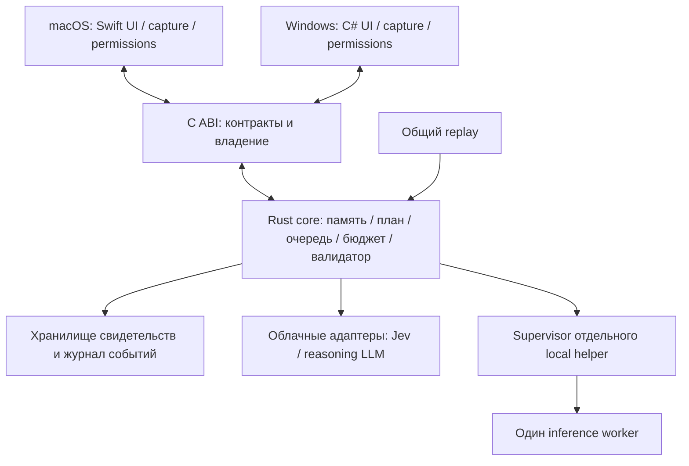

# Архитектура Ambient

**Общий слой интеграций (реализован в 23A–23C):** [ADR-019](decisions/0019-unified-integrations.md) вводит общий слой подключений в существующем Rust core с адаптерами источников. Он заменяет дублирующиеся механизмы GitHub/Jira; Todoist добавляется после его приёмки. По D60 встроенные интеграции (вкл/выкл) отделены от пользовательских плагинов (удалённые MCP, отдельная спецификация). Контракт — [ADR-020](decisions/0020-integration-layer-contract.md). После 23A Core содержит общий движок (`integration_store.rs`, `integration_types.rs`) и адаптер Jira (`jira_adapter.rs`); providers — один ограниченный транспорт интеграций; bridge — `ambient_integration.h`; macOS — один владелец секретов Keychain с привязкой к экземпляру базы и общий каркас источника. С 23B GitHub — второй адаптер того же движка (`github_adapter.rs`); прежние координаторы, транспорты, ABI и Swift-копии GitHub и Jira удалены. С 17A Todoist — третий HTTP-адаптер движка (`ADAPTERS` из трёх) и пятая встроенная интеграция; правило «`scope` неизменяем» уточнено D65 (задаётся при сохранении или один раз записывается движком), пауза из заголовка и тела (D66), без конечного `/user` (D67). С 23C Core хранит переключатели встроенных интеграций (с 17A — пять) (`integration_switches`, вид `BuiltInIntegration`); переключатель проверяется при допуске, в fence операций и в fence оснований 08B, а macOS показывает их в «Настройки › Интеграции». С 24A по [ADR-021](decisions/0021-plugins-layer.md) есть слой пользовательских плагинов: Core владеет пакетами, закреплёнными инструментами, циклом модели внутри одного `dispatch`, автосохранением процитированного, основанием 08B `Plugin` и журналами; providers — минимальный MCP-клиент 2025-06-18 и шаги модели с инструментами; bridge — модель v5 и `ambient_plugin.h` v1; macOS — настройки плагинов и общий владелец секретов `EnvelopeKeychain`. С 24C по [ADR-022](decisions/0022-local-mcp-servers.md) providers владеет запуском локальных серверов (`local_host.rs`: группы процессов, провод stdio, последовательность остановки) поверх общего `Protocol<Wire>`; мост держит таблицу операций плагинов; macOS отключает SIGPIPE при запуске (`AmbientProcess.launch`). С 24B (локально) управляемый сервер Google: `ManagedServerId` в Core (список инструментов, встроенный пакет), рецепт, установка через `uv`, провод loopback HTTP и OAuth (`oauth2` 5.0.0, реестр по ID) в providers, клиент встраивается при сборке (`build.rs`), экспорты OAuth без описателя в bridge, `ManagedServers` в macOS. Ниже описан текущий принятый код: прежнее отсутствие общего framework является историей реализации, а не запретом нового направления.

Принятый12A по [ADR-017](decisions/0017-selected-jira-issue.md) добавляет Jira Cloud в тот же Store. Core владеет профилями/исключениями CloudID, поколениями, ограниченным окном, происхождением и атомарной привязкой; providers выполняет три фиксированных GET; native хранит email/token отдельным Keychain envelope и показывает preview. Текущая schema10/Jira ABI1; прежние ABI сохранены. Отдельного Jira-чата, памяти или connector framework нет.

Принятый13A по [ADR-016](decisions/0016-selected-github-pr.md) добавляет GitHub на тот же Store: Core владеет профилями/allowlist/поколениями/сроком ожидания, нормализацией и атомарным bind; providers — четырьмя ограниченными GET; native — отдельным Keychain credential и UI. В этом пакете добавлены schema9 и GitHub ABI1; model4/memory3/auth1/source1/Codex1 не меняются. Нет общего connector framework, второй памяти или отдельного GitHub-чата.

Принятый08B по [ADR-015](decisions/0015-persistent-proposal-feed.md) добавляет постоянную область помощи в существующий Store: source dependencies, атрибутированный диалог и полный набор предложений. Schema8/model ABI4, остальные ABI прежние. Публикация — одна Immediate transaction после отдельного учёта попытки; workspace revision защищает очистку/пересоздание, content revision — адресат черновика. Native владеет только отображением, прокруткой и независимым draft. Действия проверяют полный source fence; сохранение stale-истории отличает обновление содержимого от отзыва доступа. После этого пакета принят GitHub13A.

14A по [ADR-014](decisions/0014-selected-codex-history.md) добавляет конкретный Codex-адаптер на прежнем Store: native владеет ограниченным файловым чтением, Core — настройками, закреплённым parser, окном и атомарным bind. Codex ABI1 отдельный, schema7; typed Git/Codex fences защищают всю помощь. Нет второго хранилища или общего connector framework. Постоянная лента08B принята после этого пакета.

10A по [ADR-013](decisions/0013-local-voice-reply.md): один native VoiceReplyModel, AVAudioRecorder и отдельный AmbientVoiceHelper.app с закреплённым FluidAudio/Parakeet. Голос не занимает ChatGPTCoordinator. Отмена ждёт фактического выхода процесса; файловые блокировки защищают очистку во время работы helper. Core проверяет текущий результат через существующий getter, новые Store/ledger/ABI не вводились.

Исторический пакет08A по [ADR-012](decisions/0012-edge-card-and-text-reply.md): Core владеет одним временным результатом/snapshot и заменяемым reply preview; native — одним общим черновиком и NSPanel. Model ABI3 заменяет2 без второго Store, transport, ledger или transcript. Полные source fences наследуются при каждом ответе; редактирование и read-only result getter не занимают модельный transport.

11A по [ADR-011](decisions/0011-selected-local-branches.md) добавляет local-source ABI1: native владеет выбранным root/FD и bounded read, Core — настройками/исключениями/допуском, чистым разбором Git-байтов и источником памяти. Source settings revisions защищают preview/dispatch/result/copy; второго Store или Git-процесса нет.

В06F реализована помощь по сохранённому делу по [ADR-010](decisions/0010-selected-task-assistance.md): Swift/единственный ChatGPTCoordinator → model ABI4 → Rust Responses → Core/SQLite journal и постоянная область08B → Core-validated copy. Core владеет допуском, immutable context, актуальностью и учётом; native — credentials и UI. Одна текущая schema10, memoryABI3/authABI1 неизменны. Локальные HTTP/SSE проверки пройдены; live High Fast/native consent ещё не подтверждены. Фоновое наблюдение, остальные облачные коннекторы, scheduler и денежный ledger Jev этим не реализованы.

Статус: архитектура основы проекта. Rust/Swift/C# подтверждены пользователем; конкретные API-контракты, модель и продуктовые лимиты уточняются перед реализацией соответствующего этапа. Это не описание уже работающей системы.

## Главное решение

Один Rust core владеет смыслом задачи и правилами поведения на macOS и Windows. Swift и C# получают системные факты, отображают UI и выполняют разрешённые команды. Перенос ядра на другой язык в Windows или отдельные платформенные бюджеты/память нарушают эту границу.

C ABI соединяет оболочки с ядром. Отдельный процесс нужен локальной модели, поскольку зависание inference не должно удерживать UI или облачную отправку. Это разные границы; ядро не обязано становиться отдельным сервером.

## Владельцы

| Область | Владеет | Не владеет |
| --- | --- | --- |
| Rust core | Цели, источники фактов, обязательства, очередь, routing, расходы, валидность результатов | Окна ОС, UI и системные разрешения |
| Native adapters | Захват, accessibility/UI Automation, OS permissions, геометрия, credentials, исполнение | Собственная копия памяти/планировщика |
| Bridge | Перевод DTO, длины/буферы, errors, lifetime, доставка событий | Продуктовая политика |
| Provider adapters | Протокол поставщика, preprocessing, ответ/usage/error | Разрешение на действие и обход бюджета |
| Local supervisor | Жизнь helper, поколение, readiness, stop/restart | Бесконечный restart или автоматический повтор старой очереди |
| Replay/telemetry | Наблюдаемые исходы и воспроизведение | Доказательство качества на всех приложениях |

В независимой части 07 реализованы Rust core с постоянной памятью нескольких дел/сведений/связей, ручным планом и завершением/очисткой; отдельный bridge crate с memory C ABI v3. SwiftUI-приложение использует их через статическую библиотеку. Собственный нативный вход ChatGPT по ADR-006 реализован отдельным provider crate и auth ABI1: Rust проверяет протокол, native владеет browser/listener/Keychain; HTTP не занимает UI/MemorySession. Локальные проверки пройдены, настоящий consent/refresh ещё не принят. Остальные перечисленные области ещё не реализованы. Новые crates появляются только для реальной границы сборки или FFI; отдельные папки не требуют отдельного сервиса.

## Поток наблюдения

1. Нативный адаптер проверяет область доступа и фиксирует наблюдённое событие.
2. Свидетельство короткого события попадает в ограниченный журнал **до debounce и модели**. Для заменяемого состояния — один running и один pending latest-state.
3. Память привязывает факт к цели, сущности и источнику. Смена приложения не обнуляет задачу.
4. План выбирает активные вопросы по событию, изменению задачи или времени. Неизменная картинка не подавляет таймер.
5. Диспетчер проверяет deadline, возможности исполнителя, качество, ресурсы, доступ к данным и денежный резерв.
6. Completion проходит проверку смысловых зависимостей. ActionProposal отдельно проверяется перед исполнением и подтверждается ожидаемым результатом после него.

## Свидетельства и память

Храним оригинал доступного наблюдения и происхождение производных изображений: crop, scale, padding, orientation, display ID, geometry revision. Системные frame buffers не удерживаются на время модели. Текст accessibility дополняет картинку, но не заменяет её.

Ограничения задаются по байтам и числу элементов, включая декодированные/временные копии. При переполнении объединяем повторения и вытесняем незакреплённое; неполнота записывается как ObservationLoss. Для самого счётчика потерь нужен ограниченный резерв.

Память организована по задачам и сущностям, не по foreground-приложению. Факты имеют источники, время и статус; summaries — индекс со ссылками. Для первого постоянного хранилища выбран [ADR-003](decisions/0003-foundation-storage-and-native-boundary.md): SQLite в Rust, явная ошибка неизвестной схемы, без автоматической миграции отсутствующего старого продукта. Это решение текущей реализации; проверенные возможности перечислены в статусе проекта.

## Маршрутизация и расходы

Начальный baseline — прямое облако по требуемой способности. Jev рассматривается для узкого структурированного решения; генерация содержания идёт reasoning LLM. Последовательность local → Jev → LLM не обязательна.

P0 — остановка/отзыв действия; P1 — срочное/дорогое по последствиям; P2 — обычная помощь; P3 — обслуживание/исследование. Облако имеет отдельную ограниченную concurrency и резерв P1. Срочные задачи не ждут local. При недоступности облака сохраняется явный исход «не проверено/отложено», а не ложное отрицание.

Local включается только после измерений конкретного класса, версии, preprocessing и устройства. Один worker; cold load отдельно допускается по бюджету ресурсов. Deadline использует монотонные часы и оценку полного маршрута. Fallback отправляется в последний полезный момент независимо от завершения local cancel. Worker остаётся занят до фактического завершения inference или helper process. Поколение процесса защищает от поздних ответов старой instance; restart ограничен попытками и cooldown.

Ledger хранит spent/reserved/available. Каждый платный запрос резервируется до отправки, включая retry, fallback и shadow. Неизвестный usage удерживает резерв. Если нет верхней оценки стоимости и внешнего ограничения, строгий денежный потолок означает отказ от отправки. Thermal fallback не обходит ledger.

## Действия и ошибки

Изменение цели/target/геометрии/разрешений может инвалидировать действие, но не обязано стирать полезный исторический факт. Проверяются зависимости конкретного результата. Не передаём один глобальный `isFresh` на все сущности.

Нормальные исходы: успех, отмена, истёкший срок, stale dependency, нет разрешения/бюджета/сети, неподдерживаемая capability, неполное наблюдение, ошибка provider/helper. Они видны в телеметрии с редактированными данными. UI и облако продолжают работать при падении optional helper.

## Платформы

macOS: ScreenCaptureKit, accessibility, SwiftUI/AppKit, Keychain. Windows: Windows Graphics Capture, UI Automation, C# native UI и системный secret store. Подписки и полнота событий различаются; координаты переводятся на стороне ОС. На Windows отдельно проверяются resize, HDR, scaling и device loss.

[Контракты](contracts.md), [приватность](privacy.md), [проверки](testing.md), [принятые решения](decisions/README.md).
